<!-- Generated from docs/ux-surfaces.yaml by scripts/ux_surface_map.py. Do not edit: change the map and re-run. -->

# UX surface map: App Launcher Lite

Every surface a person can reach in this app, each under a stable id that its root element carries as `data-surface`. Each area has a diagram of how its surfaces connect; a rounded node is a surface in another area.

One single-page app: five tabs (Board, Code, Team, Apps, Jobs) in the vendored nav, Settings behind the gear in every tab's header. Phone first; at 1100px and wider with a fine pointer the nav is a left rail and the Code tab is a list beside the session view. Every sheet is a native dialog with a header close and one full-width primary action. The coding agent is GitHub Copilot CLI and the forge is GitLab, so the Board lists GitLab issues and merge requests and the Code tab launches Copilot. Features that need a folder or a registry (Team OS skills, mini apps, the chief) show their empty state until Settings points at one. Ids are `<area>.<surface>`; the e2e capture hook takes the same ids.

Walked 2026-11-18 against build `52a7d40`, at widths 390, 1280, themes light, dark.

## Areas

| Area | Surfaces |
|---|---|
| [Chrome](#chrome) | 11 |
| [Code](#code) | 14 |
| [Terminal](#terminal) | 9 |
| [Chat](#chat) | 6 |
| [Screen](#screen) | 4 |
| [Apps](#apps) | 12 |
| [Jobs](#jobs) | 10 |
| [Team OS](#team-os) | 7 |
| [Board](#board) | 16 |
| [Settings](#settings) | 18 |
| [Keys and gestures](#keys-and-gestures) | 4 |

## Chrome

What every tab shares - the nav, each tab's header, the toast and the dialogs any tab can raise.

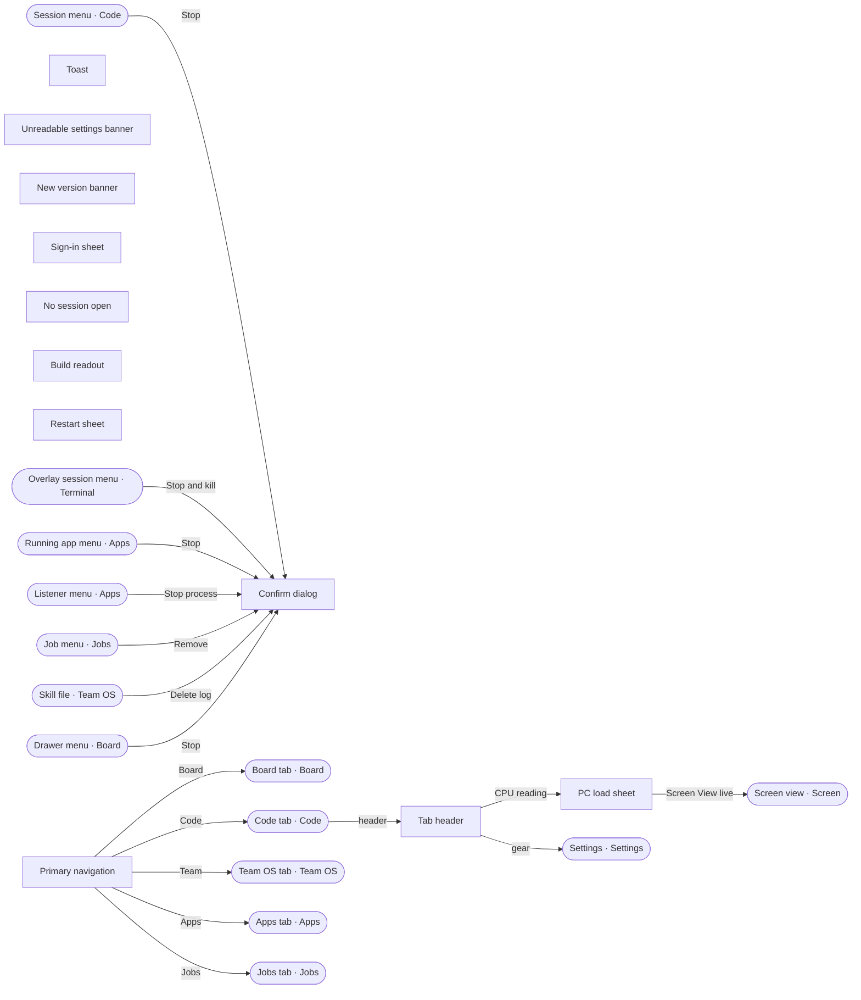

### `chrome.nav` Primary navigation

- **Root:** `data-surface`
- **Reach:** always on screen
- **Holds:**
  - five tabs in order Board, Code, Team, Apps, Jobs, each an icon and a label
  - a count badge on the Board tab while something waits on the owner
- **Does:**
  - switches the pane and keeps the choice in the page state
  - a tab switch leaves Settings and, in the wide layout, closes the docked session view when Code is left
- **Phone:** a floating pill at the bottom edge
- **Desktop:** a left rail 80px wide
- **Why:** the fleet navigation contract; Settings is no tab, the header gear opens it
- **Leads to:**
  - [Board tab](#boardtab-board-tab) (Board)
  - [Code tab](#codetab-code-tab) (Code)
  - [Team OS tab](#teamtab-team-os-tab) (Team)
  - [Apps tab](#appstab-apps-tab) (Apps)
  - [Jobs tab](#jobstab-jobs-tab) (Jobs)

### `chrome.home-head` Tab header

- **Root:** none — the same vendored home-head markup sits at the top of all six panes, so no single id can name it.
- **Reach:** the top of every tab and of Settings
- **Holds:**
  - the tab's icon and title
  - one status line that names only exceptions, worst first, and falls back to a plain count
  - the CPU reading button, a muted percentage that takes a tone at 70 and 90 percent and shows a dash when the server could not read it
  - a small dot on the CPU reading's corner while the hub reports the machine as watch or needing action
  - the theme toggle
  - the Settings gear
- **Does:**
  - the CPU reading opens the PC load sheet
  - the theme toggle flips light and dark and keeps the choice
  - the gear opens Settings
- **States:** the gear is the only way into Settings; Settings itself shows no gear
- **Leads to:**
  - [PC load sheet](#chromecpu-sheet-pc-load-sheet) (CPU reading)
  - [Settings](#settingspane-settings) (gear)

### `chrome.cpu-sheet` PC load sheet

- **Root:** `data-surface`
- **Reach:** the CPU reading in any tab header
- **Holds:**
  - the PC's private IP address
  - a Health row with the hub's verdict (OK, Watch, Needs action or Not confirmed) and the hub's reason and suggested fix under it
  - rows for ports in use, memory commit, the load on each disk, the top port holders and the last port exhaustion, when the hub measured them
  - the load reading and what is using it
  - a Screen row with a View live action
  - a toast area for the result of a copy
  - Done
- **Does:**
  - Copy on the IP row puts the address on the clipboard
  - View live opens the Screen view
- **States:**
  - Unknown instead of an address, with Copy disabled, when the PC's address could not be read
  - Not confirmed instead of OK, with the reason in words, when no hub is set, the hub does not answer in time, its answer is not a verdict or the last reading is too old; the machine rows are then absent
- **Leads to:** [Screen view](#screenview-screen-view) (Screen View live)

### `chrome.toast` Toast

- **Root:** `data-surface`
- **Reach:** shown by an action's result, a copy, a long-press hint or a context ring tap
- **Holds:** one status line that dismisses itself
- **States:** lives on the body, outside the app wrapper, so the nav cannot clip it

### `chrome.config-error` Unreadable settings banner

- **Root:** `data-surface`
- **Reach:** appears by itself above every tab while the settings file cannot be read
- **Holds:** the file, the parse error, and that remote access is off until the file is fixed and the app restarted
- **States:**
  - hidden whenever the settings file reads, or is not there yet
  - only the PC itself sees it, since every other caller is refused outright

### `app.update-banner` New version banner

- **Root:** `data-surface`
- **Reach:** appears by itself when the server reports a build other than the one the page booted on
- **Holds:**
  - the text New version available
  - Reload
  - a dismiss button
- **Does:**
  - Reload reloads the page; it is only ever the user's tap
  - dismiss keeps it down until the server moves to yet another build
- **States:** a server back on the boot build hides it
- **Why:** the vendored build-watch component stamps this id itself, and every fleet app lists it

### `shared.login` Sign-in sheet

- **Root:** none — the vendored sign-in component builds the sheet itself and this copy does not stamp an id.
- **Reach:** raised by any request the server answers with 401
- **Holds:** a password field and the sign-in action
- **Does:** a successful sign-in stores the token and boots the page again
- **States:** only one sheet is open however many requests fail at once

### `chrome.confirm-dialog` Confirm dialog

- **Root:** `data-surface`
- **Reach:** stopping a session or a running app, removing a job, running a job that asks for confirmation, and other destructive or costly actions
- **Holds:**
  - a title and a message
  - an optional typed-confirmation field
  - the Confirm action
- **Does:** Confirm resolves the action; the header close or Escape cancels it
- **Why:** one themed dialog stands in for the browser's confirm so a phone shows the same sheet everywhere

### `chrome.detail-empty` No session open

- **Root:** `data-surface`
- **Reach:** the Code tab in the wide layout while no session is open
- **Holds:** No session open and the line A session opens here, beside the list
- **States:** hidden below 1100px and on a coarse pointer
- **Desktop:** the detail pane's resting state

### `chrome.build-readout` Build readout

- **Root:** `data-surface`
- **Reach:** the foot of every pane
- **Holds:** the build identity of the running server
- **Does:** a tap or Enter opens the restart sheet
- **Why:** the vendored page-foot, so a phone shows which build it is looking at

### `app.restart-sheet` Restart sheet

- **Root:** `data-surface`
- **Reach:** a tap on the build readout
- **Holds:**
  - a picker, Restart app or Restart session-host
  - a status line and, after a failure, the recipe's last log lines
  - one primary action named after the picked target
- **Does:**
  - Restart app runs the repo's own tray restart, waits for the new build and reloads
  - Restart session-host first shows how many live terminal sessions it will end, and runs only on a second tap, Restart anyway
  - a failed, timed-out or unconfirmed restart says so and does not reload
- **States:** refused without the passkey (or the PC itself), a restart already running, restarted, failed, not confirmed, timed out
- **Why:** the fleet's vendored page-foot restart sheet; the app declares its two targets in app/webapp/restart_targets.py

## Code

The default tab. The session list and the project list; a session opens in the terminal overlay.

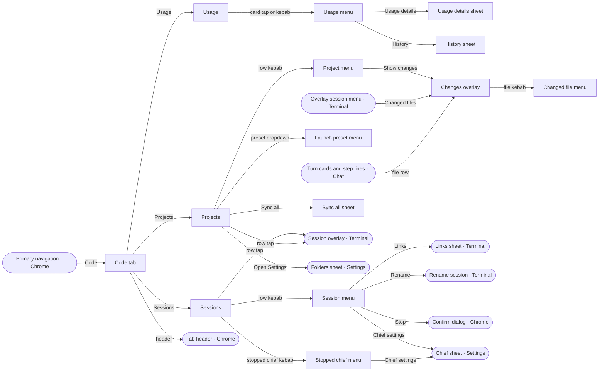

### `code.tab` Code tab

- **Root:** `data-surface`
- **Reach:**
  - the Code tab
  - the page's default tab
- **Holds:**
  - the tab header
  - the Usage card
  - the Sessions card
  - the Projects card
- **Desktop:** the list sits left of the docked session view
- **Leads to:**
  - [Usage](#codeusage-usage) (Usage)
  - [Sessions](#codesessions-sessions) (Sessions)
  - [Projects](#codeprojects-projects) (Projects)
  - [Tab header](#chromehome-head-tab-header) (header)

### `code.usage` Usage

- **Root:** `data-surface`
- **Reach:** the first card on the Code tab
- **Holds:**
  - the pace words beside the title, under pace or ahead of pace in their tone
  - one Copilot · Month row with a bar filled to the share of the Copilot plan's monthly allowance used, as the Copilot CLI's own status line shows it, a tick at the share of the month gone, the percent and the reset date
  - a footnote with today's credits on this machine, after the reason when the plan figure could not be read
  - a kebab on the card's head
- **Does:**
  - a tap anywhere on the card, the kebab included, opens the Usage menu
  - the bar is accent on or under pace, attention ahead of it and danger at 90% or more
  - an unreadable plan figure reads unknown with its reason, never 0% and never this machine's share in its place
  - the row's tooltip names the source, the Copilot plan as the CLI last fetched it, its scope, and this machine's credits this month
  - reads every 60 s while the Code tab is on screen, never during page load
- **Why:** one glance says whether the month's Copilot allowance will last
- **Leads to:** [Usage menu](#codeusage-menu-usage-menu) (card tap or kebab)

### `code.usage-menu` Usage menu

- **Root:** `data-surface`
- **Reach:** a tap on the Usage card, or its kebab
- **Holds:** Usage details and History
- **Does:**
  - Usage details opens the Usage details sheet
  - History opens the History sheet
- **Leads to:**
  - [Usage details sheet](#codeusage-sheet-usage-details-sheet) (Usage details)
  - [History sheet](#codehistory-sheet-history-sheet) (History)

### `code.usage-sheet` Usage details sheet

- **Root:** `data-surface`
- **Reach:** Usage details in the Usage menu
- **Holds:** the figures the card's bar and tooltip carry, written out - credits used of the allowance, the share of the month gone, the reset date, this machine's credits this month and today, and the source
- **Does:**
  - an unreadable plan figure reads unknown with its reason and shows no used count
  - Done or the header close closes the sheet

### `code.sessions` Sessions

- **Root:** `data-surface`
- **Reach:** the second card on the Code tab, open by default
- **Holds:**
  - the chief's row first, running or stopped
  - one row per session this launcher started, with an avatar, a one-line title and a status line
  - on a Copilot row whose screen shows its AI credits, the figure beside the age
  - a kebab on every row
- **Does:**
  - a row's tap opens the session in the terminal overlay, or in Chat when Open in Chat is on
  - a stopped chief row offers Start and Resume
- **States:** empty - No sessions launched from here yet, with a Show projects action that opens the Projects card
- **Leads to:**
  - [Session overlay](#terminaloverlay-session-overlay) (row tap)
  - [Session menu](#codesession-menu-session-menu) (row kebab)
  - [Stopped chief menu](#codechief-menu-stopped-chief-menu) (stopped chief kebab)

### `code.session-menu` Session menu

- **Root:** `data-surface`
- **Reach:** a session row's kebab
- **Holds:**
  - Terminal and Chat
  - Links
  - Open in new window
  - Copy path
  - Rename
  - Stop, in the danger tone
  - for the running chief, Restart and Chief settings
- **Does:**
  - Terminal and Chat open the overlay in that mode
  - Stop asks for confirmation, then kills the session
- **Leads to:**
  - [Links sheet](#terminallinks-sheet-links-sheet) (Links)
  - [Rename session](#terminalrename-dialog-rename-session) (Rename)
  - [Confirm dialog](#chromeconfirm-dialog-confirm-dialog) (Stop)
  - [Chief sheet](#settingschief-chief-sheet) (Chief settings)

### `code.chief-menu` Stopped chief menu

- **Root:** `data-surface`
- **Reach:** the kebab on the chief's row while no chief runs
- **Holds:** Chief settings; Restart is hidden while nothing runs
- **Leads to:** [Chief sheet](#settingschief-chief-sheet) (Chief settings)

### `code.projects` Projects

- **Root:** `data-surface`
- **Reach:** the second card on the Code tab, closed by default
- **Holds:**
  - the launch toolbar, with a launch preset dropdown when a preset is saved
  - Sync all and Refresh for the git check
  - a filter box with a favorites toggle
  - one row per project folder, with its git flag
  - the time of the last git check
- **Does:**
  - a project row launches the coding agent in that folder
  - a preset picked in the toolbar launches it on that preset's model, effort and context
  - Refresh fetches every remote and re-reads branch, changes and ahead or behind
  - Sync all fast-forwards every clean project that is only behind
- **States:**
  - empty - No projects found, with an Open Settings action that opens the Folders sheet
  - filtered to nothing - No projects match the filter, with Clear filter
  - the favorites toggle narrows the list to starred projects
- **Leads to:**
  - [Project menu](#codeproject-menu-project-menu) (row kebab)
  - [Launch preset menu](#codepreset-menu-launch-preset-menu) (preset dropdown)
  - [Sync all sheet](#codegit-sync-sheet-sync-all-sheet) (Sync all)
  - [Folders sheet](#settingsfolders-folders-sheet) (Open Settings)
  - [Session overlay](#terminaloverlay-session-overlay) (row tap)

### `code.preset-menu` Launch preset menu

- **Root:** `data-surface`
- **Reach:** the preset dropdown first on the Projects launch toolbar, drawn only once a preset is saved for a model on the Copilot list
- **Holds:** Default and one row per saved preset, each named with its effort and context tier
- **Does:**
  - picking a row sets the model, effort and context the next launch sends, and is remembered on this device
  - Default sends nothing extra, so the saved Copilot settings apply

### `code.project-menu` Project menu

- **Root:** `data-surface`
- **Reach:** a project row's kebab
- **Holds:** the issues link, Open in VS Code, Show changes, Pull and Open folder
- **Does:**
  - items the project cannot do are greyed with a hint
  - Show changes opens the working-tree overlay
- **Leads to:** [Changes overlay](#codechanges-overlay-changes-overlay) (Show changes)

### `code.git-sync-sheet` Sync all sheet

- **Root:** `data-surface`
- **Reach:** Sync all in the Projects card
- **Holds:**
  - while it runs, "Syncing 3 of 26" with the project being synced
  - the report: how many projects were fast-forwarded, already current, skipped (grouped by reason) and failed
  - the result of the run, project by project
  - Done
- **Does:** Done closes the sheet; closed mid-run, the same count stays in a toast and the totals replace it when the run ends, with Report to reopen the sheet

### `code.history-sheet` History sheet

- **Root:** `data-surface`
- **Reach:** History in the Usage menu
- **Holds:**
  - a day, week or month grouping and a range of 30 days, 90 days, 6 months or a custom pair of days
  - tiles for lines added and removed, merge requests merged and issues opened and closed, each with a chart
  - a per-project table sortable by column
  - the data sources, each with its age, and the projects skipped for having no GitLab remote
  - Refresh and Done
- **Does:**
  - opens on the saved figures at once, however old, with a line saying when they were last refreshed, and makes no refresh, git or GitLab call
  - Refresh re-reads local git and GitLab for every project; a neutral toast counts them (Checking 3 of 26) while it runs, the sheet updates in place, and the toast ends on a summary such as Refreshed 25 of 26 with 1 skipped (no GitLab remote)
  - the summary toast takes the error style only when a read failed, and then names the projects it failed for; a skipped project never does
  - a column header sorts the project table
  - Done or the header close closes the sheet
- **States:**
  - loading - Reading the history, until the first answer
  - error - Could not read the history, with Retry, when no figure has loaded yet
  - stale - the last figures stay under a stale line when a later read fails
  - a source that was never read shows unknown, one whose last read failed shows stale, a project with no GitLab remote shows skipped; none of them is drawn as zero
  - a GitLab read that filled a page of 100 says older days may be incomplete
  - the By project card keeps its title on one line with the project count as a subtitle below it, down to a 360 px screen

### `code.changes-overlay` Changes overlay

- **Root:** `data-surface`
- **Reach:**
  - Show changes in the project menu
  - Changed files in a session menu
  - a file chip or the Edited N files card in Chat
- **Holds:**
  - a title, a refresh button and a close
  - one collapsible row per file with a status badge, the path and plus or minus counts
  - a diff that loads the first time its row opens
- **Does:**
  - a project shows git's unified diff, tinted per line; a session shows each of its own edits in order, folded from the transcript
  - a session also lists files only git status shows it changed (a command wrote them), marked from git status, with git's diff
  - nothing here stages, commits or discards
- **States:**
  - empty - nothing changed
  - loading and error lines in a status strip
- **Leads to:** [Changed file menu](#codechanges-file-menu-changed-file-menu) (file kebab)

### `code.changes-file-menu` Changed file menu

- **Root:** `data-surface`
- **Reach:** a file row's kebab in the changes overlay
- **Holds:** Copy content, Copy diff, Copy path, Open on PC

## Terminal

The session overlay in its terminal mode - the live PTY, the composer under it, the menus on the bar.

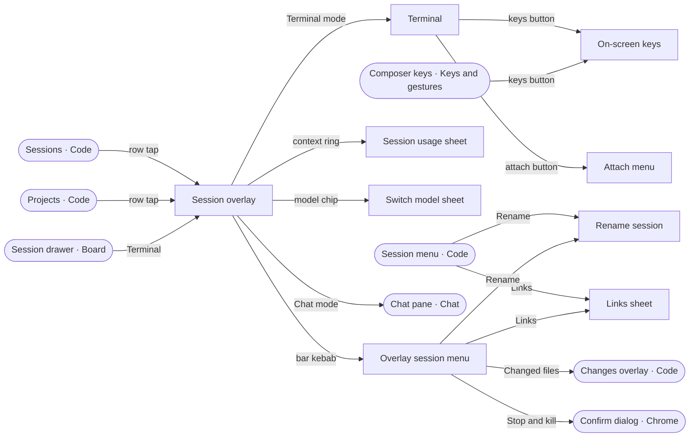

### `terminal.overlay` Session overlay

- **Root:** `data-surface`
- **Reach:** a session row, a project launch, the Board drawer's Terminal or Chat, a ?session= link
- **Holds:**
  - a bar with Back, the session title, the model chip, the context ring, the Terminal and Chat toggle and the session menu
  - the terminal host and its composer
  - a status strip
- **Does:**
  - Back closes the overlay
  - the toggle swaps Terminal and Chat without reconnecting
- **States:**
  - a session with no transcript reader offers no Chat
  - the model chip hides when the model is not known
  - the context ring hides when the agent's screen shows no context figure, as on a Copilot session too narrow for its status line
  - a Copilot session whose footer shows its AI credits gets a label beside the ring, such as 9% · 5.6 AIC
- **Phone:** covers the page
- **Desktop:** docks beside the session list in the wide layout
- **Leads to:**
  - [Terminal](#terminalhost-terminal) (Terminal mode)
  - [Switch model sheet](#terminalmodel-sheet-switch-model-sheet) (model chip)
  - [Session usage sheet](#terminalcontext-sheet-session-usage-sheet) (context ring)
  - [Chat pane](#chatoverlay-chat-pane) (Chat mode)
  - [Overlay session menu](#terminalsession-menu-overlay-session-menu) (bar kebab)

### `terminal.host` Terminal

- **Root:** `data-surface`
- **Reach:** the Terminal side of the overlay toggle
- **Holds:**
  - the xterm screen
  - a Jump to latest button once scrolled back
  - the composer bar
  - a status strip and an activity line
- **Does:**
  - the page connects the PTY lazily and a reconnect redraws from the kept history
  - the screen follows its box, with the last row above the composer; it takes more rows when the box grows and pans when it shrinks
  - a phone takes the terminal's size back when a desktop browser on the same session changed it, so its screen never stays garbled
- **Leads to:**
  - [On-screen keys](#terminalkeys-popover-on-screen-keys) (keys button)
  - [Attach menu](#terminalattach-menu-attach-menu) (attach button)

### `terminal.session-menu` Overlay session menu

- **Root:** `data-surface`
- **Reach:** the kebab on the overlay bar
- **Holds:**
  - Rename, Copy link, Changed files, Links
  - in Chat mode Show or Hide steps, Show or Hide automatic, Load new and Reload
  - Compact, for a Copilot session
  - Stop and kill
- **Does:**
  - Compact sends /compact to the session and toasts the host's verdict
  - Copy link copies the provider's own session URL, else the launcher link, and the toast says which
- **Leads to:**
  - [Rename session](#terminalrename-dialog-rename-session) (Rename)
  - [Links sheet](#terminallinks-sheet-links-sheet) (Links)
  - [Changes overlay](#codechanges-overlay-changes-overlay) (Changed files)
  - [Confirm dialog](#chromeconfirm-dialog-confirm-dialog) (Stop and kill)

### `terminal.context-sheet` Session usage sheet

- **Root:** `data-surface`
- **Reach:** the context ring in the session view's bar
- **Holds:**
  - the context window used, as a percentage
  - the AI credits used this session, only when a Copilot footer shows them
- **Does:** Done closes

### `terminal.model-sheet` Switch model sheet

- **Root:** `data-surface`
- **Reach:** the model chip in the session view's bar, shown for a Copilot session
- **Holds:**
  - a note saying the switch is for this session only and the Settings default stays
  - one row per model on the Copilot list, the current one checked
- **Does:**
  - a pick types Copilot's own /model for this session and waits for its event log to report the change
  - Done closes
- **States:**
  - a switch the server could not confirm leaves the old model showing and says why
  - a busy Copilot, unsent prompt text or an open menu refuses the switch before anything is typed

### `terminal.rename-dialog` Rename session

- **Root:** `data-surface`
- **Reach:** Rename in either session menu
- **Holds:**
  - a field whose blank value means the automatic title
  - Save

### `terminal.links-sheet` Links sheet

- **Root:** `data-surface`
- **Reach:** Links in either session menu
- **Holds:**
  - the artifacts and URLs the transcript mentioned, in groups Artifacts, GitHub, Servers and previews, Other
  - each group folded to its name and count, newest row first
  - a note on how far back the read reached with Read more
  - Done
- **Does:**
  - a row opens the link in a new tab and its copy button copies the URL
  - credential-looking query strings were already removed by the server

### `terminal.keys-popover` On-screen keys

- **Root:** `data-surface`
- **Reach:** the keys button in the composer
- **Holds:**
  - arrow keys, Esc, Tab and Enter
  - sticky Shift and Ctrl, only one engaged at a time
- **Does:**
  - each key writes its escape sequence down the PTY input channel
  - the popover stays open across arrow and Tab taps
- **Why:** phone keyboards that lack these keys still need an agent's prompts to be navigable

### `terminal.attach-menu` Attach menu

- **Root:** `data-surface`
- **Reach:** the attach button on a composer
- **Holds:** Photo, Extract text (OCR), Attach file (to context) and Attach large file (not read)
- **Does:**
  - an upload stores the file on the PC and puts its path in the message
  - several picks queue behind each other and show N of M
- **Why:** the composer is shared by the terminal, Chat, the Board drawer and the answer sheet

## Chat

The session overlay in its chat mode - the same session read from the agent's own history.

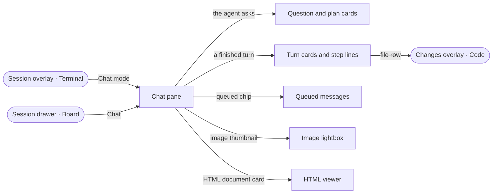

### `chat.overlay` Chat pane

- **Root:** `data-surface`
- **Reach:**
  - the Chat side of the overlay toggle
  - Open in Chat
- **Holds:**
  - the transcript, newest page first, with Load older
  - a Latest button once scrolled up
  - the queued-messages chip
  - the composer
- **Does:** the agent's replies and the user's prompts show expanded and everything else folds into one step line per run
- **States:**
  - empty, loading and error lines in the transcript state strip
  - a detached session has no terminal, so a note says delivery is typed into the PC console and not confirmed
- **Leads to:**
  - [Queued messages](#chatqueued-sheet-queued-messages) (queued chip)
  - [Image lightbox](#chatlightbox-image-lightbox) (image thumbnail)
  - [HTML viewer](#chathtml-viewer-html-viewer) (HTML document card)
  - [Question and plan cards](#chatdecision-cards-question-and-plan-cards) (the agent asks)
  - [Turn cards and step lines](#chatturn-cards-turn-cards-and-step-lines) (a finished turn)

### `chat.decision-cards` Question and plan cards

- **Root:** none — drawn inside the transcript list, which carries no id of its own for a card.
- **Reach:** while the agent asks a question or waits on a plan
- **Holds:**
  - the question card with numbered options, an Other field and Done
  - the plan card, answered from the terminal's own screen
  - the resume card, a searchable list of the project's conversations, shown while the terminal's picker is open
- **Does:** an option sends its answer into the session

### `chat.turn-cards` Turn cards and step lines

- **Root:** none — rows in the transcript list, drawn by the transcript renderer without a root of their own.
- **Reach:** every finished turn
- **Holds:**
  - the Edited N files card with a total and one row per file, showing the first few and Show N more
  - file chips in a reply
  - one step line per run of tool calls, opening item by item
  - a divider row that folds turns nobody typed
- **Does:** a file row or the card header opens the changes overlay
- **Leads to:** [Changes overlay](#codechanges-overlay-changes-overlay) (file row)

### `chat.queued-sheet` Queued messages

- **Root:** `data-surface`
- **Reach:** the queued chip in the Chat pane
- **Holds:**
  - the messages the session holds that the agent has not taken yet
  - a Discard on each
  - Done
- **States:** empty - The agent has taken everything

### `chat.lightbox` Image lightbox

- **Root:** `data-surface`
- **Reach:** a transcript thumbnail
- **Holds:** the full-size image and a close button
- **Does:** a tap anywhere dismisses it

### `chat.html-viewer` HTML viewer

- **Root:** `data-surface`
- **Reach:** a sent HTML document's card
- **Holds:** the file name, a close button, the document and a Download link
- **Does:** the document shows without scripts, in a frame with an empty sandbox
- **Why:** an HTML document never renders same-origin or scriptable

## Screen

The PC's desktop, live, behind the terminal's passkey gate.

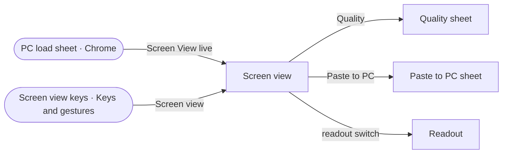

### `screen.view` Screen view

- **Root:** `data-surface`
- **Reach:** View live in the PC load sheet
- **Holds:**
  - the live frame of the PC's desktop
  - modes View, Control, Touch and Trackpad
  - a keyboard button, a quality button and a handle that shows or hides the controls
  - a keys bar with Esc, Tab, Ctrl, Alt, Win, Del, the F keys, Task Mgr, Paste to PC and Paste plus Ctrl+V
- **Does:**
  - the server sends a frame only when the screen changes, so a still picture is a quiet socket
  - capture runs only while a viewer is connected
- **States:** reconnecting and unavailable states
- **Phone:** opens full screen
- **Desktop:** pops out into its own window, /?screen=1
- **Leads to:**
  - [Quality sheet](#screenquality-sheet-quality-sheet) (Quality)
  - [Paste to PC sheet](#screenpaste-sheet-paste-to-pc-sheet) (Paste to PC)
  - [Readout](#screenreadout-readout) (readout switch)

### `screen.paste-sheet` Paste to PC sheet

- **Root:** `data-surface`
- **Reach:** Paste to PC when the phone does not let the page read its clipboard
- **Holds:** a text box and Send to PC

### `screen.quality-sheet` Quality sheet

- **Root:** `data-surface`
- **Reach:** the Quality button in the Screen view
- **Holds:**
  - the quality choices
  - the Readout switch
  - Done

### `screen.readout` Readout

- **Root:** none — a line drawn inside the Screen view while the Readout switch is on.
- **Reach:** the Readout switch in the quality sheet
- **Holds:** frames a second, data a second, the average frame size and the time from confirming to the picture

## Apps

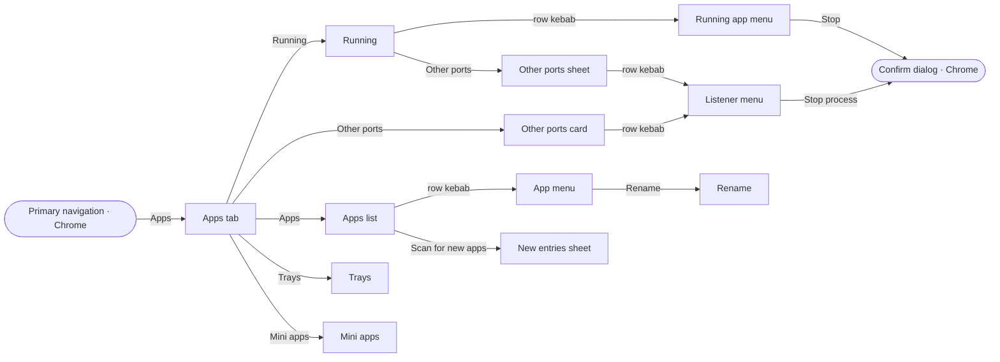

### `apps.tab` Apps tab

- **Root:** `data-surface`
- **Reach:** the Apps tab
- **Holds:**
  - the tab header
  - Running, Other ports, Apps, Trays and Mini apps cards
- **Leads to:**
  - [Running](#appsrunning-running) (Running)
  - [Other ports card](#appsother-ports-card-other-ports-card) (Other ports)
  - [Apps list](#appsapps-apps-list) (Apps)
  - [Trays](#appstrays-trays) (Trays)
  - [Mini apps](#appsmini-apps-mini-apps) (Mini apps)

### `apps.running` Running

- **Root:** `data-surface`
- **Reach:** the first card on the Apps tab
- **Holds:**
  - one row per app launched from here, with a kebab
  - an Other ports row that opens the sheet
  - an idle line and the note Only apps launched from here appear
- **States:**
  - empty - Nothing launched from here is running, with Show apps
  - an error line in a status strip
- **Leads to:**
  - [Running app menu](#appsrunning-menu-running-app-menu) (row kebab)
  - [Other ports sheet](#appsother-ports-sheet-other-ports-sheet) (Other ports)

### `apps.running-menu` Running app menu

- **Root:** `data-surface`
- **Reach:** a running app's kebab
- **Holds:**
  - a header line with the process id
  - Copy URL and Stop
- **Leads to:** [Confirm dialog](#chromeconfirm-dialog-confirm-dialog) (Stop)

### `apps.other-ports-card` Other ports card

- **Root:** `data-surface`
- **Reach:** the Apps tab in the wide layout
- **Holds:** the listeners on common app ports that this launcher did not start
- **Phone:** the Other ports row in Running opens the same list as a sheet
- **Desktop:** a card beside the lists
- **Leads to:** [Listener menu](#appslistener-menu-listener-menu) (row kebab)

### `apps.other-ports-sheet` Other ports sheet

- **Root:** `data-surface`
- **Reach:** the Other ports row in the Running card
- **Holds:**
  - the listeners
  - Check again
- **States:** empty - Nothing running on common app ports; the launcher itself is not listed
- **Leads to:** [Listener menu](#appslistener-menu-listener-menu) (row kebab)

### `apps.listener-menu` Listener menu

- **Root:** `data-surface`
- **Reach:** a listener row's kebab
- **Holds:** Open, Copy URL and Stop process in the danger tone
- **Leads to:** [Confirm dialog](#chromeconfirm-dialog-confirm-dialog) (Stop process)

### `apps.apps` Apps list

- **Root:** `data-surface`
- **Reach:** the Apps card
- **Holds:**
  - a filter box
  - one row per registered app, each with a kind and a kebab
  - the Scan for new apps row
- **States:**
  - empty - No apps registered yet, with Scan for apps
  - filtered to nothing - No apps match the filter, with Clear filter
  - an error line in a status strip
- **Leads to:**
  - [App menu](#appsapp-menu-app-menu) (row kebab)
  - [New entries sheet](#appsscan-sheet-new-entries-sheet) (Scan for new apps)

### `apps.app-menu` App menu

- **Root:** `data-surface`
- **Reach:** an app row's kebab
- **Holds:** Launch visible, Open link, Copy URL, Rename, Copy path
- **Leads to:** [Rename](#appsrename-dialog-rename) (Rename)

### `apps.rename-dialog` Rename

- **Root:** `data-surface`
- **Reach:** Rename in the app menu
- **Holds:** a field and Save
- **Why:** one dialog serves every rename on the Apps tab

### `apps.scan-sheet` New entries sheet

- **Root:** `data-surface`
- **Reach:** Scan for new apps, or the empty state's action
- **Holds:**
  - the entries the scan found, grouped, each selectable
  - Add selected
- **Does:** Add selected writes the chosen rows to the registry

### `apps.trays` Trays

- **Root:** `data-surface`
- **Reach:** the Trays card, closed by default
- **Holds:**
  - one row per sister tray found, with a switch for starting with the launcher
  - the note that switched trays start with App Launcher Lite
- **States:** empty - No sister trays found yet, with Scan for trays

### `apps.mini-apps` Mini apps

- **Root:** `data-surface`
- **Reach:** the Mini apps card
- **Holds:** one row per mini app with a start-on-launch switch
- **States:**
  - hidden until the server reports a mini-apps folder
  - empty - No mini apps found yet, with Scan for mini apps

## Jobs

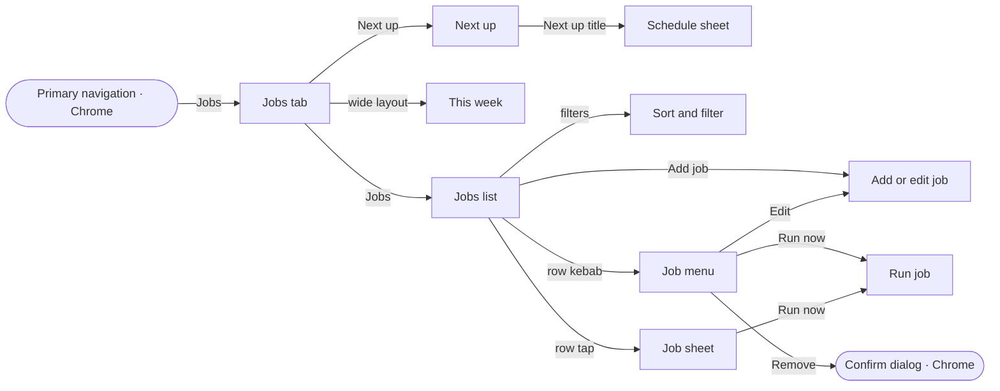

### `jobs.tab` Jobs tab

- **Root:** `data-surface`
- **Reach:** the Jobs tab
- **Holds:**
  - the tab header
  - the Next up card
  - the Jobs card
- **Desktop:** the detail pane's resting state is the This week schedule
- **Leads to:**
  - [Next up](#jobsnext-up-next-up) (Next up)
  - [Jobs list](#jobslist-jobs-list) (Jobs)
  - [This week](#jobsweek-this-week) (wide layout)

### `jobs.next-up` Next up

- **Root:** `data-surface`
- **Reach:** the top card on the Jobs tab
- **Holds:**
  - the next scheduled runs
  - a button on its title that opens the schedule
- **States:** loading, empty and error lines
- **Leads to:** [Schedule sheet](#jobsagenda-sheet-schedule-sheet) (Next up title)

### `jobs.agenda-sheet` Schedule sheet

- **Root:** `data-surface`
- **Reach:** the Next up title
- **Holds:**
  - the schedule over the coming days
  - Done

### `jobs.week` This week

- **Root:** `data-surface`
- **Reach:** the Jobs tab in the wide layout with no job open
- **Holds:** the week's runs

### `jobs.list` Jobs list

- **Root:** `data-surface`
- **Reach:** the Jobs card
- **Holds:**
  - a search box over jobs and run output, a filters button and an add button
  - one row per job with its last status, a spark of recent runs and a kebab
- **States:**
  - loading - Loading jobs
  - empty - No jobs registered yet, with Add job
  - no match - No jobs or run output match the search, with Clear search
- **Leads to:**
  - [Sort and filter](#jobssort-sheet-sort-and-filter) (filters)
  - [Add or edit job](#jobsjob-dialog-add-or-edit-job) (Add job)
  - [Job sheet](#jobsjob-sheet-job-sheet) (row tap)
  - [Job menu](#jobsjob-menu-job-menu) (row kebab)

### `jobs.sort-sheet` Sort and filter

- **Root:** `data-surface`
- **Reach:** the filters button in the jobs search
- **Holds:**
  - Sort by Next run or A to Z
  - Clear and Done

### `jobs.job-menu` Job menu

- **Root:** `data-surface`
- **Reach:** a job row's kebab
- **Holds:** Run now, Pause or Resume, Dry-run check, Edit, Remove in the danger tone
- **Leads to:**
  - [Run job](#jobsrun-dialog-run-job) (Run now)
  - [Add or edit job](#jobsjob-dialog-add-or-edit-job) (Edit)
  - [Confirm dialog](#chromeconfirm-dialog-confirm-dialog) (Remove)

### `jobs.job-sheet` Job sheet

- **Root:** `data-surface`
- **Reach:** a job row's tap
- **Holds:**
  - the job's name, schedule and latest runs with their output
  - Run now
- **Leads to:** [Run job](#jobsrun-dialog-run-job) (Run now)

### `jobs.run-dialog` Run job

- **Root:** `data-surface`
- **Reach:** Run now from the menu or the sheet
- **Holds:**
  - a field for each declared parameter
  - a Dry run switch
  - Run
- **Does:** a dry run asks scripts that support it to skip their side effects

### `jobs.job-dialog` Add or edit job

- **Root:** `data-surface`
- **Reach:** the add button, Add job in the empty state, Edit in the job menu
- **Holds:**
  - name, kind, the script file or inline body or HTTP check fields, arguments
  - a schedule with its type fields, cooldown and exclusive group
  - switch for Require confirmation
  - the run-on-success and run-on-failure chains, parameters and a webhook
  - Save anyway and Add and verify
- **Does:**
  - the fields shown follow the kind and the schedule type
  - Add and verify checks the script before saving; Save anyway skips that check
- **States:** a verification failure keeps the dialog open with the reason

## Team OS

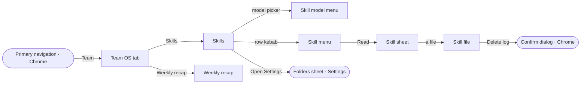

### `team.tab` Team OS tab

- **Root:** `data-surface`
- **Reach:** the Team tab
- **Holds:**
  - the tab header
  - the Skills card
  - the Weekly recap card
- **Leads to:**
  - [Skills](#teamskills-skills) (Skills)
  - [Weekly recap](#teamrecap-weekly-recap) (Weekly recap)

### `team.skills` Skills

- **Root:** `data-surface`
- **Reach:** the Skills card
- **Holds:**
  - a model picker for the launched skill
  - the launch toolbar
  - a filter box
  - one row per skill found under the Team OS folder, each with a kebab
- **States:**
  - empty - No team-os skills found, with an Open Settings action that opens the Folders sheet
  - filtered to nothing - No skills match the filter, with Clear filter
  - an error line in a status strip
- **Leads to:**
  - [Skill model menu](#teammodel-menu-skill-model-menu) (model picker)
  - [Skill menu](#teamskill-menu-skill-menu) (row kebab)
  - [Folders sheet](#settingsfolders-folders-sheet) (Open Settings)

### `team.model-menu` Skill model menu

- **Root:** `data-surface`
- **Reach:** the model picker above the skills
- **Holds:** Default and every model Settings offers

### `team.skill-menu` Skill menu

- **Root:** `data-surface`
- **Reach:** a skill row's kebab
- **Holds:** Start new session, Pick a session, Read
- **Leads to:** [Skill sheet](#teamskill-sheet-skill-sheet) (Read)

### `team.skill-sheet` Skill sheet

- **Root:** `data-surface`
- **Reach:** Read in the skill menu
- **Holds:**
  - the skill's files
  - Done
- **Leads to:** [Skill file](#teamdoc-sheet-skill-file) (a file)

### `team.doc-sheet` Skill file

- **Root:** `data-surface`
- **Reach:** a file in the skill sheet
- **Holds:**
  - the file's text
  - Rename log and Delete log for a log file
  - Done
- **Leads to:** [Confirm dialog](#chromeconfirm-dialog-confirm-dialog) (Delete log)

### `team.recap` Weekly recap

- **Root:** `data-surface`
- **Reach:** under the Skills card
- **Holds:** the weekly recap rows
- **States:** hidden until there is a recap

## Board

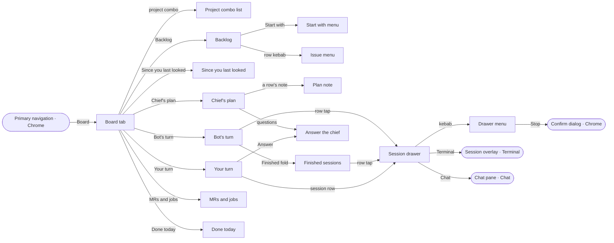

### `board.tab` Board tab

- **Root:** `data-surface`
- **Reach:**
  - the Board tab
  - a ?board= deep link
- **Holds:**
  - the tab header
  - a project combo, Refresh and Collapse all
  - the lanes Backlog, Since you last looked, Chief's plan, Bot's turn, Your turn, MRs and jobs and Done today
- **Does:**
  - Refresh runs glab for GitLab issues, merge requests and what finished today
  - the project combo narrows every lane to one repository
- **States:** a status strip and a fetch-state strip, each hidden until there is something to say
- **Desktop:** the Board spans the whole width right of the rail
- **Leads to:**
  - [Project combo list](#boardrepo-menu-project-combo-list) (project combo)
  - [Backlog](#boardbacklog-backlog) (Backlog)
  - [Since you last looked](#boardjournal-since-you-last-looked) (Since you last looked)
  - [Chief's plan](#boardchief-plan-chiefs-plan) (Chief's plan)
  - [Bot's turn](#boardbots-turn-bots-turn) (Bot's turn)
  - [Your turn](#boardyour-turn-your-turn) (Your turn)
  - [MRs and jobs](#boardmrs-jobs-mrs-and-jobs) (MRs and jobs)
  - [Done today](#boarddone-done-today) (Done today)

### `board.repo-menu` Project combo list

- **Root:** `data-surface`
- **Reach:** typing in or focusing the project box
- **Holds:** the repositories that match, and a clear button on the box
- **States:** the box reads All projects when nothing is chosen

### `board.backlog` Backlog

- **Root:** `data-surface`
- **Reach:** the Backlog lane
- **Holds:**
  - a count and a Start with model picker
  - issue rows grouped in buckets, each with a kebab
- **Does:** Start and YOLO on a row use the picked model
- **States:** empty and error lines
- **Leads to:**
  - [Start with menu](#boardmodel-menu-start-with-menu) (Start with)
  - [Issue menu](#boardissue-menu-issue-menu) (row kebab)

### `board.model-menu` Start with menu

- **Root:** `data-surface`
- **Reach:** the Start with picker in the Backlog
- **Holds:** Default and every model Settings offers

### `board.issue-menu` Issue menu

- **Root:** `data-surface`
- **Reach:** a Backlog row's kebab
- **Holds:** YOLO (start and ship), Open on GitLab, Copy link

### `board.journal` Since you last looked

- **Root:** `data-surface`
- **Reach:** a card above Chief's plan
- **Holds:**
  - the chief's journal entries, new ones first
  - Clear
- **Does:** Clear stamps the last look on the server, so every device agrees
- **States:**
  - hidden when there is no journal file
  - a journal that cannot be read is one muted line, never a toast
  - with no new entry the card shows one line and no button

### `board.chief-plan` Chief's plan

- **Root:** `data-surface`
- **Reach:** the card under Backlog
- **Holds:**
  - the chief's lanes, its queue and what waits on the owner
  - Clear merged
  - a row's note, when it has one
- **Leads to:**
  - [Plan note](#boardplan-note-sheet-plan-note) (a row's note)
  - [Answer the chief](#boardanswer-sheet-answer-the-chief) (questions)

### `board.plan-note-sheet` Plan note

- **Root:** `data-surface`
- **Reach:** a plan row that carries a note
- **Holds:**
  - the row's title, repo and number, model and status
  - the note in full
  - Open on GitLab when the row links to an issue
- **Why:** a phone has no hover, so the note is read in a sheet

### `board.bots-turn` Bot's turn

- **Root:** `data-surface`
- **Reach:** the lane under Chief's plan
- **Holds:** live sessions that are working or about to be, one row each, counted in the lane's summary
- **Does:** a row opens the drawer
- **States:** empty line
- **Leads to:**
  - [Session drawer](#boarddrawer-session-drawer) (row tap)
  - [Finished sessions](#boardfinished-group-finished-sessions) (Finished fold)

### `board.finished-group` Finished sessions

- **Root:** `data-surface`
- **Reach:** the Finished fold at the bottom of Bot's turn, shown only while a session is finished
- **Holds:** sessions that finished or sat idle for two hours, one row each, outside the lane's count
- **Does:**
  - the fold opens and shuts, shut by default
  - a row opens the drawer
- **States:** hidden while no session is finished
- **Leads to:** [Session drawer](#boarddrawer-session-drawer) (row tap)

### `board.your-turn` Your turn

- **Root:** `data-surface`
- **Reach:** the lane under Bot's turn
- **Holds:**
  - live sessions waiting on the owner
  - a needs folder trust chip on a session sitting on Copilot's trust prompt
  - the chief's row with a mailbox unread chip, only while the doorbell is on and a mailbox event has waited 15 minutes
  - the owner-check groups Before you start, Validate to close and Try what shipped, one fold each
- **Does:**
  - a row unfolds its detail in place
  - Trust this folder on a needs-folder-trust row answers Copilot's prompt with remember this folder
  - a group's Answer opens the answer sheet
- **Leads to:**
  - [Session drawer](#boarddrawer-session-drawer) (session row)
  - [Answer the chief](#boardanswer-sheet-answer-the-chief) (Answer)

### `board.drawer` Session drawer

- **Root:** none — the drawer is the open row's own list item, kept across the poll re-render, so it has no element of its own.
- **Reach:** a live session row in Bot's turn or Your turn
- **Holds:**
  - the last exchange between the user and the agent
  - the shared composer
  - Chat and Terminal
  - a kebab with Rename and Stop
- **Does:**
  - the chief's exchange poll and a live mic stop when the drawer closes
  - a row opened before the drawer's code has loaded shows its exchange being read, then the drawer
- **Leads to:**
  - [Drawer menu](#boarddrawer-menu-drawer-menu) (kebab)
  - [Session overlay](#terminaloverlay-session-overlay) (Terminal)
  - [Chat pane](#chatoverlay-chat-pane) (Chat)

### `board.drawer-menu` Drawer menu

- **Root:** `data-surface`
- **Reach:** the drawer's kebab
- **Holds:** Rename and Stop in the danger tone
- **Leads to:** [Confirm dialog](#chromeconfirm-dialog-confirm-dialog) (Stop)

### `board.answer-sheet` Answer the chief

- **Root:** `data-surface`
- **Reach:** Answer in an owner-check group or a chief question
- **Holds:**
  - one block per waiting item with its options, the recommended one already picked
  - an Other field on every item
  - an Anything else box
  - Done
- **Does:**
  - Done sends every answer at once
  - tap a web address in a question or its detail opens it in a new tab
- **Why:** one sheet answers everything that waits, instead of one dialog per question

### `board.mrs-jobs` MRs and jobs

- **Root:** `data-surface`
- **Reach:** the lane under Your turn, closed by default
- **Holds:**
  - merge requests and pipeline jobs, one row each
  - a project whose default-branch pipeline is red, one row each with a CI failed chip that opens the failed pipeline on GitLab
- **States:**
  - empty line
  - a project whose pipelines could not be read, one row with a CI unknown chip

### `board.done` Done today

- **Root:** `data-surface`
- **Reach:** the last lane, closed by default
- **Holds:**
  - what finished today
  - Show earlier, which adds one more day per tap up to a week
- **States:** empty line

## Settings

A group list in a pane; every row that holds more than a switch opens a sheet with a back arrow to the pane.

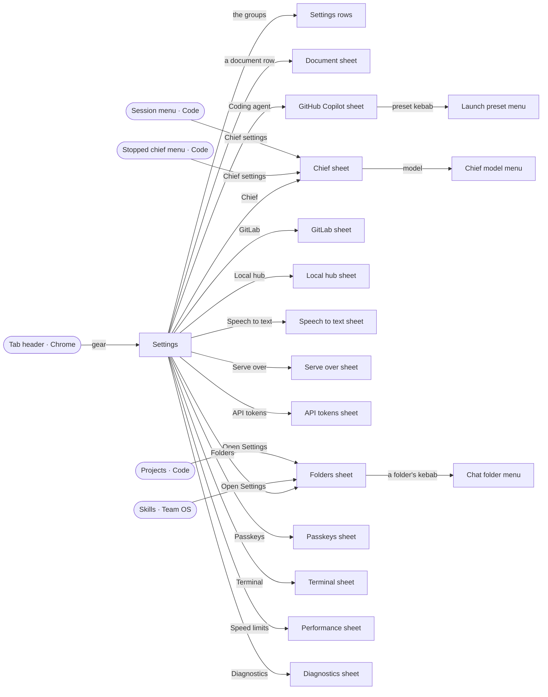

### `settings.pane` Settings

- **Root:** `data-surface`
- **Reach:** the gear in any tab header
- **Holds:** Documents, Appearance, Agents, Sessions, Board, Performance, Connections and This PC groups
- **Does:** a tab switch leaves it
- **States:** the Documents group is hidden until the server lists documents; an unreadable list shows Couldn't read the documents list with Retry
- **Leads to:**
  - [Settings rows](#settingsgroups-settings-rows) (the groups)
  - [Document sheet](#settingsdocument-document-sheet) (a document row)
  - [GitHub Copilot sheet](#settingscopilot-github-copilot-sheet) (Coding agent)
  - [Chief sheet](#settingschief-chief-sheet) (Chief)
  - [GitLab sheet](#settingsgitlab-gitlab-sheet) (GitLab)
  - [Performance sheet](#settingsperformance-performance-sheet) (Speed limits)
  - [Serve over sheet](#settingsserving-serve-over-sheet) (Serve over)
  - [Speech to text sheet](#settingsspeech-speech-to-text-sheet) (Speech to text)
  - [Local hub sheet](#settingshub-local-hub-sheet) (Local hub)
  - [API tokens sheet](#settingstokens-api-tokens-sheet) (API tokens)
  - [Folders sheet](#settingsfolders-folders-sheet) (Folders)
  - [Passkeys sheet](#settingspasskeys-passkeys-sheet) (Passkeys)
  - [Terminal sheet](#settingsterminal-terminal-sheet) (Terminal)
  - [Diagnostics sheet](#settingsdiagnostics-diagnostics-sheet) (Diagnostics)

### `settings.groups` Settings rows

- **Root:** none — rows inside the Settings pane, which has one root for all of them.
- **Reach:** the Settings pane
- **Holds:**
  - Appearance - a Text size choice of Small, Default and Large; a Full screen on Edge switch with a hint line, shown only in Edge; an Install as app row that says whether this browser can install Lite and why not
  - Sessions - the Open in a new window switch, Window browser (Chrome, Edge, Default) and the Open in Chat switch, with a help line that explains all three
  - This PC - the switches Start at log on, Awake with lid closed and Prevent lock, each with a help line
- **Does:**
  - a switch saves when tapped and shows ON or OFF
  - Full screen on Edge hides the address bar and toolbar, is remembered on this device, and comes back on the first tap after a reload; the switch is the one way to turn it off
- **States:**
  - Full screen on Edge is absent in any browser that is not Edge or has no full screen for web pages
  - Full screen on Edge, on but out of full screen after a reload or the back gesture, adds a Tap anywhere to go full screen line
  - Install as app shows Installed, Ready, Blocked, Not offered or Unavailable, with a sentence under the group
  - Awake with lid closed is hidden on a machine that cannot set it, and shows its own status line

### `settings.document` Document sheet

- **Root:** `data-surface`
- **Reach:** a row in the Documents group
- **Holds:**
  - the document's text
  - Copy Markdown and Open on GitHub
  - Retry when the read failed
  - Done

### `settings.copilot` GitHub Copilot sheet

- **Root:** `data-surface`
- **Reach:** Coding agent in Agents
- **Holds:**
  - Model, Effort and Context choices
  - switches for Autopilot, Skip permission prompts and Remote session, with a line saying whether Copilot's own setting is on now
  - the sign-in instruction
  - Models offered, one id per line
  - a line with an Add button when the saved list lacks a default model
  - Usage card, the fallback monthly allowance in AI credits the Code tab's Usage card names when the plan's own allowance cannot be read, with a line naming its source and scope
  - Launch presets, the saved list with a kebab on each row and one form (name, model from the list above, effort the model offers, context tier) that adds a preset or, from Edit, changes one
  - Done
- **Does:**
  - Effort applies only with a model picked here
  - Add appends the missing default models to the saved list
  - a preset is saved as it is added, edited, renamed on its row or removed, and then appears in the Coding launch dropdown; a refusal shows under the field it is about
  - Remote session is applied at each Copilot launch from Coding, Team OS and the Board; off starts sessions unshared
- **Why:** Copilot takes its model at launch from here and has no in-session switch the launcher drives
- **Leads to:** [Launch preset menu](#settingspreset-menu-launch-preset-menu) (preset kebab)

### `settings.chief` Chief sheet

- **Root:** `data-surface`
- **Reach:**
  - Chief in Agents
  - Chief settings in a chief menu
- **Holds:**
  - the chief's model, context and effort, and a worker cap
  - a line naming a saved chief model the Copilot list no longer offers
  - a switch for counting only chief-dispatched sessions
  - a Skills folder field, with a line saying whether each issue skill is found, missing or unknown
  - Automations - Doorbell, Fallback check in minutes, Auto-drain queue, Auto-compact with its threshold, Job failures, Job self-heal and Weekly proposals
  - Timings - Doorbell re-ring in seconds, Unread mail alert, Re-offer claimed mail and Turn-end hold in minutes
  - How the chief works - the fixed timings, each with its value and reason, and the fixed rules, read-only
  - a one-line explanation under every control
  - Done
- **Does:**
  - each switch saves when tapped and no restart is needed
  - Fallback check saves on change; 0 turns it off
  - each Timings field saves on change within its range and applies without a restart
  - model, context and effort apply when the chief next starts; Same as Coding agent follows that sheet
  - a chief model outside the Copilot list starts on Copilot's own pick, with a warning
  - the Skills folder saves on blur; empty uses the bundled issue skills, and a lane start is refused while one is missing
- **Leads to:** [Chief model menu](#settingschief-model-menu-chief-model-menu) (model)

### `settings.chief-model-menu` Chief model menu

- **Root:** `data-surface`
- **Reach:** the Model picker in the Chief sheet
- **Holds:** Default and every model Settings offers

### `settings.gitlab` GitLab sheet

- **Root:** `data-surface`
- **Reach:** GitLab in Board
- **Holds:**
  - the GitLab group and the GitLab host, blank meaning gitlab.com
  - Done
- **Does:** glab must be signed in to the host on this PC

### `settings.hub` Local hub sheet

- **Root:** `data-surface`
- **Reach:** Local hub in Connections
- **Holds:**
  - the hub address, blank meaning no hub
  - Use the local hub, which fills the hub-lite address and saves it
  - Done, and a result line
- **Does:**
  - the address saves as it changes (on leaving the field or Enter)
  - a non-blank address is saved only when the hub answers /healthz now; a bad address or a hub that does not answer is refused with the reason, the saved value stays and the field goes back to it
  - saving a blank address turns the hub off; either change takes effect without a restart
  - the PC load sheet's Health row reads Not confirmed, with the reason, while no hub is set or the hub does not answer
- **States:** the Settings row reads Off, or the saved host and port

### `settings.speech` Speech to text sheet

- **Root:** `data-surface`
- **Reach:** Speech to text in Connections
- **Holds:**
  - a Dictation switch, the Base URL, an optional Model and an optional API key that is never shown again
  - Remove key, once a key is set
  - Test connection, with its result line
  - Keep recordings (hours), 0 keeping none
  - Recent recordings, newest first, with Refresh; each take shows its time, length and status, with Play and Transcribe, a transcript with Copy once transcribed, and the browser's own reason beside the error of a take it could not convert
  - Done
- **Does:**
  - every field saves as it changes
  - Test connection sends a short test recording with the saved settings and reports Transcribes, Refuses audio, Reachable (transcription not confirmed), Refused or Unknown, with a reason
  - with Dictation off no record button shows in any message box
  - the recordings list loads each time the sheet opens; Play fetches the kept audio, Transcribe converts it to 16 kHz mono WAV in the browser and sends that to the saved endpoint (the stored recording goes as it is only where the browser cannot convert, and the server then needs ffmpeg)
- **States:**
  - the Settings row reads Off, On or No URL
  - a take reads Recording, Transcribed, Failed (with the reason, and why its browser could not convert it when that was recorded), Not transcribed or Incomplete (its page closed mid-take)
  - with nothing kept the list reads No recordings kept; a list that could not be read says so

### `settings.serving` Serve over sheet

- **Root:** `data-surface`
- **Reach:** Serve over in Connections
- **Holds:**
  - Automatic, HTTPS, HTTP and Both, one of them pressed
  - a line saying whether this page is on a secure address
  - HTTP port, shown only for Both
  - a line, shown only when the last start could not bind that port, saying plain HTTP is off and HTTPS is still served
  - the certificate on this PC, with Create certificate when there is none
  - help on what a self-signed certificate still blocks and the no-install routes to a trusted one
  - Done
- **Does:**
  - a mode or port saves at once and applies when the app restarts
  - Create certificate writes a self-signed pair for this PC's names into webapp/certificates/ and never replaces one
- **States:**
  - the Settings row reads Automatic, HTTPS, HTTP or Both, and Both adds the HTTP port
  - the certificate line reads No certificate, a self-signed certificate or a certificate, with its expiry date

### `settings.preset-menu` Launch preset menu

- **Root:** `data-surface`
- **Reach:** the kebab on a saved launch preset in the GitHub Copilot sheet
- **Holds:**
  - Edit
  - Remove

### `settings.tokens` API tokens sheet

- **Root:** `data-surface`
- **Reach:** API tokens in Connections
- **Holds:**
  - the tokens that each run one job from a link
  - a label, a job and Create token, with the value shown once beside Copy
  - Done
- **States:** empty - No tokens yet, with Create a token

### `settings.folders` Folders sheet

- **Root:** `data-surface`
- **Reach:**
  - Folders in This PC
  - an empty state's Open Settings
- **Holds:**
  - Projects folder, Hidden projects, Apps folder, Team OS folder and Copilot folder
  - Chat file folders with an Add action and one row per folder
  - Done
- **Leads to:** [Chat folder menu](#settingsoutbox-menu-chat-folder-menu) (a folder's kebab)

### `settings.outbox-menu` Chat folder menu

- **Root:** `data-surface`
- **Reach:** a Chat file folder's kebab
- **Holds:** Remove

### `settings.passkeys` Passkeys sheet

- **Root:** `data-surface`
- **Reach:** Passkeys in This PC
- **Holds:**
  - the enrollment status
  - Enroll this device
  - Done
- **States:** enrolling is only offered while the tray's enrollment window is open

### `settings.terminal` Terminal sheet

- **Root:** `data-surface`
- **Reach:** Terminal in This PC
- **Holds:**
  - Terminal history in lines and the Large file limit in MB
  - the switches Allow private network without Tailscale and Also allow screen view without Tailscale, each with a help line
  - Done
- **Does:**
  - turning either switch on asks first, with a warning that names what it opens; turning it off saves at once
  - a switch saves through the passkey unlock and works only on the PC itself or over Tailscale
- **States:** the screen switch is off and dimmed while the private-network switch is off, and turns off with it

### `settings.performance` Performance sheet

- **Root:** `data-surface`
- **Reach:** Speed limits in Performance
- **Holds:**
  - a Machine preset choice of Standard, Light machine and Custom, with a help line
  - a read-only health line with CPU, free memory, requests in flight, agent processes and lanes against the worker cap
  - a field for each speed limit, each with its default and range in a help line - the Board, session list and open chat refresh in seconds, a switch to pause while the tab is hidden, the thread pools for session and Board reads, transcript reads, sends, other requests and git status, the git status cache, the transcript page cache, the transcript tail cache, the missing-log wait and the request budget scale
  - Done
- **Does:**
  - each field saves when it is left and a value the server refuses stays in the field with the reason under it
  - choosing a preset saves every limit at once; nothing needs a restart
- **States:**
  - Custom is dimmed until the values match neither preset; choosing it does nothing, since it names a state
  - a health figure that could not be read says unknown with the reason, never zero

### `settings.diagnostics` Diagnostics sheet

- **Root:** `data-surface`
- **Reach:** Diagnostics in This PC
- **Holds:**
  - a Window choice of Last 15 minutes, Last hour and Last 3 hours, with a help line naming what is collected and that secrets are removed
  - Save diagnostics
- **Does:**
  - Save diagnostics writes one redacted text file of every Lite log in the window on the PC and shows its record count, size and path
  - Download the file appears once a file is saved and hands it to the browser
  - both go through the passkey unlock

## Keys and gestures

Inputs that are not elements.

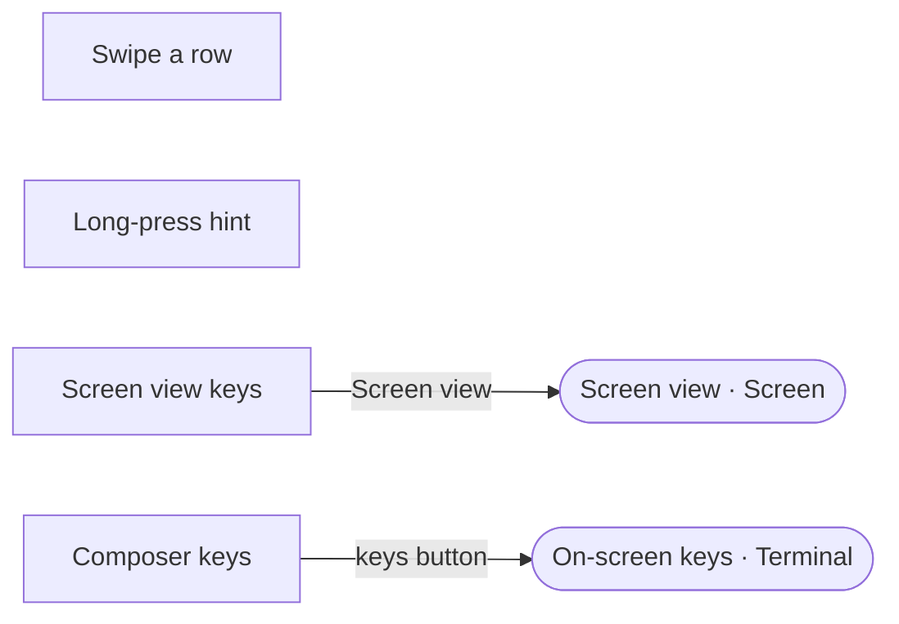

### `keys.swipe-row` Swipe a row

- **Root:** none — a touch gesture on a list row, with no element of its own.
- **Reach:** a horizontal drag on a row that declares swipe actions, on touch or a pen
- **Does:**
  - a partial swipe rests open on the action and a tap commits it; a full swipe or a fast flick commits as released
  - a mouse never swipes, so the row's kebab is the route on a desktop
  - a drag that starts in the leftmost 24px is left to the system back gesture
- **Why:** the kebab is the single-pointer alternative a path gesture needs

### `keys.long-press-hint` Long-press hint

- **Root:** none — a hold on an icon-only control, which toasts its title.
- **Reach:** holding the context ring, the Terminal and Chat toggle or the keys button for half a second
- **Does:**
  - the toast says what the control does, since a touch screen has no hover
  - the hold never triggers the control

### `keys.screen` Screen view keys

- **Root:** none — key and pointer paths into the Screen view, with no element of their own.
- **Reach:** a hardware keyboard, the phone keyboard raised by the keyboard button, a three-finger tap
- **Does:**
  - a hardware key goes to the PC, combined with the keys bar's sticky modifiers
  - the keyboard button and a three-finger tap raise and lower the phone keyboard
  - the keys bar follows the visual viewport while the phone keyboard is up
- **Leads to:** [Screen view](#screenview-screen-view) (Screen view)

### `keys.composer` Composer keys

- **Root:** none — key paths in the shared composer, with no element of their own.
- **Reach:** the composer in the terminal, Chat, the Board drawer and the answer sheet
- **Does:**
  - Send forwards the text over the PTY socket, then a submitting Enter as a separate frame
  - a paste of an image or files queues an upload
- **Leads to:** [On-screen keys](#terminalkeys-popover-on-screen-keys) (keys button)

## Link index

| From | Via | To |
|---|---|---|
| [Primary navigation](#chromenav-primary-navigation) | Board | [Board tab](#boardtab-board-tab) |
| [Primary navigation](#chromenav-primary-navigation) | Code | [Code tab](#codetab-code-tab) |
| [Primary navigation](#chromenav-primary-navigation) | Team | [Team OS tab](#teamtab-team-os-tab) |
| [Primary navigation](#chromenav-primary-navigation) | Apps | [Apps tab](#appstab-apps-tab) |
| [Primary navigation](#chromenav-primary-navigation) | Jobs | [Jobs tab](#jobstab-jobs-tab) |
| [Tab header](#chromehome-head-tab-header) | CPU reading | [PC load sheet](#chromecpu-sheet-pc-load-sheet) |
| [Tab header](#chromehome-head-tab-header) | gear | [Settings](#settingspane-settings) |
| [PC load sheet](#chromecpu-sheet-pc-load-sheet) | Screen View live | [Screen view](#screenview-screen-view) |
| [Code tab](#codetab-code-tab) | Usage | [Usage](#codeusage-usage) |
| [Code tab](#codetab-code-tab) | Sessions | [Sessions](#codesessions-sessions) |
| [Code tab](#codetab-code-tab) | Projects | [Projects](#codeprojects-projects) |
| [Code tab](#codetab-code-tab) | header | [Tab header](#chromehome-head-tab-header) |
| [Usage](#codeusage-usage) | card tap or kebab | [Usage menu](#codeusage-menu-usage-menu) |
| [Usage menu](#codeusage-menu-usage-menu) | Usage details | [Usage details sheet](#codeusage-sheet-usage-details-sheet) |
| [Usage menu](#codeusage-menu-usage-menu) | History | [History sheet](#codehistory-sheet-history-sheet) |
| [Sessions](#codesessions-sessions) | row tap | [Session overlay](#terminaloverlay-session-overlay) |
| [Sessions](#codesessions-sessions) | row kebab | [Session menu](#codesession-menu-session-menu) |
| [Sessions](#codesessions-sessions) | stopped chief kebab | [Stopped chief menu](#codechief-menu-stopped-chief-menu) |
| [Session menu](#codesession-menu-session-menu) | Links | [Links sheet](#terminallinks-sheet-links-sheet) |
| [Session menu](#codesession-menu-session-menu) | Rename | [Rename session](#terminalrename-dialog-rename-session) |
| [Session menu](#codesession-menu-session-menu) | Stop | [Confirm dialog](#chromeconfirm-dialog-confirm-dialog) |
| [Session menu](#codesession-menu-session-menu) | Chief settings | [Chief sheet](#settingschief-chief-sheet) |
| [Stopped chief menu](#codechief-menu-stopped-chief-menu) | Chief settings | [Chief sheet](#settingschief-chief-sheet) |
| [Projects](#codeprojects-projects) | row kebab | [Project menu](#codeproject-menu-project-menu) |
| [Projects](#codeprojects-projects) | preset dropdown | [Launch preset menu](#codepreset-menu-launch-preset-menu) |
| [Projects](#codeprojects-projects) | Sync all | [Sync all sheet](#codegit-sync-sheet-sync-all-sheet) |
| [Projects](#codeprojects-projects) | Open Settings | [Folders sheet](#settingsfolders-folders-sheet) |
| [Projects](#codeprojects-projects) | row tap | [Session overlay](#terminaloverlay-session-overlay) |
| [Project menu](#codeproject-menu-project-menu) | Show changes | [Changes overlay](#codechanges-overlay-changes-overlay) |
| [Changes overlay](#codechanges-overlay-changes-overlay) | file kebab | [Changed file menu](#codechanges-file-menu-changed-file-menu) |
| [Session overlay](#terminaloverlay-session-overlay) | Terminal mode | [Terminal](#terminalhost-terminal) |
| [Session overlay](#terminaloverlay-session-overlay) | model chip | [Switch model sheet](#terminalmodel-sheet-switch-model-sheet) |
| [Session overlay](#terminaloverlay-session-overlay) | context ring | [Session usage sheet](#terminalcontext-sheet-session-usage-sheet) |
| [Session overlay](#terminaloverlay-session-overlay) | Chat mode | [Chat pane](#chatoverlay-chat-pane) |
| [Session overlay](#terminaloverlay-session-overlay) | bar kebab | [Overlay session menu](#terminalsession-menu-overlay-session-menu) |
| [Terminal](#terminalhost-terminal) | keys button | [On-screen keys](#terminalkeys-popover-on-screen-keys) |
| [Terminal](#terminalhost-terminal) | attach button | [Attach menu](#terminalattach-menu-attach-menu) |
| [Overlay session menu](#terminalsession-menu-overlay-session-menu) | Rename | [Rename session](#terminalrename-dialog-rename-session) |
| [Overlay session menu](#terminalsession-menu-overlay-session-menu) | Links | [Links sheet](#terminallinks-sheet-links-sheet) |
| [Overlay session menu](#terminalsession-menu-overlay-session-menu) | Changed files | [Changes overlay](#codechanges-overlay-changes-overlay) |
| [Overlay session menu](#terminalsession-menu-overlay-session-menu) | Stop and kill | [Confirm dialog](#chromeconfirm-dialog-confirm-dialog) |
| [Chat pane](#chatoverlay-chat-pane) | queued chip | [Queued messages](#chatqueued-sheet-queued-messages) |
| [Chat pane](#chatoverlay-chat-pane) | image thumbnail | [Image lightbox](#chatlightbox-image-lightbox) |
| [Chat pane](#chatoverlay-chat-pane) | HTML document card | [HTML viewer](#chathtml-viewer-html-viewer) |
| [Chat pane](#chatoverlay-chat-pane) | the agent asks | [Question and plan cards](#chatdecision-cards-question-and-plan-cards) |
| [Chat pane](#chatoverlay-chat-pane) | a finished turn | [Turn cards and step lines](#chatturn-cards-turn-cards-and-step-lines) |
| [Turn cards and step lines](#chatturn-cards-turn-cards-and-step-lines) | file row | [Changes overlay](#codechanges-overlay-changes-overlay) |
| [Screen view](#screenview-screen-view) | Quality | [Quality sheet](#screenquality-sheet-quality-sheet) |
| [Screen view](#screenview-screen-view) | Paste to PC | [Paste to PC sheet](#screenpaste-sheet-paste-to-pc-sheet) |
| [Screen view](#screenview-screen-view) | readout switch | [Readout](#screenreadout-readout) |
| [Apps tab](#appstab-apps-tab) | Running | [Running](#appsrunning-running) |
| [Apps tab](#appstab-apps-tab) | Other ports | [Other ports card](#appsother-ports-card-other-ports-card) |
| [Apps tab](#appstab-apps-tab) | Apps | [Apps list](#appsapps-apps-list) |
| [Apps tab](#appstab-apps-tab) | Trays | [Trays](#appstrays-trays) |
| [Apps tab](#appstab-apps-tab) | Mini apps | [Mini apps](#appsmini-apps-mini-apps) |
| [Running](#appsrunning-running) | row kebab | [Running app menu](#appsrunning-menu-running-app-menu) |
| [Running](#appsrunning-running) | Other ports | [Other ports sheet](#appsother-ports-sheet-other-ports-sheet) |
| [Running app menu](#appsrunning-menu-running-app-menu) | Stop | [Confirm dialog](#chromeconfirm-dialog-confirm-dialog) |
| [Other ports card](#appsother-ports-card-other-ports-card) | row kebab | [Listener menu](#appslistener-menu-listener-menu) |
| [Other ports sheet](#appsother-ports-sheet-other-ports-sheet) | row kebab | [Listener menu](#appslistener-menu-listener-menu) |
| [Listener menu](#appslistener-menu-listener-menu) | Stop process | [Confirm dialog](#chromeconfirm-dialog-confirm-dialog) |
| [Apps list](#appsapps-apps-list) | row kebab | [App menu](#appsapp-menu-app-menu) |
| [Apps list](#appsapps-apps-list) | Scan for new apps | [New entries sheet](#appsscan-sheet-new-entries-sheet) |
| [App menu](#appsapp-menu-app-menu) | Rename | [Rename](#appsrename-dialog-rename) |
| [Jobs tab](#jobstab-jobs-tab) | Next up | [Next up](#jobsnext-up-next-up) |
| [Jobs tab](#jobstab-jobs-tab) | Jobs | [Jobs list](#jobslist-jobs-list) |
| [Jobs tab](#jobstab-jobs-tab) | wide layout | [This week](#jobsweek-this-week) |
| [Next up](#jobsnext-up-next-up) | Next up title | [Schedule sheet](#jobsagenda-sheet-schedule-sheet) |
| [Jobs list](#jobslist-jobs-list) | filters | [Sort and filter](#jobssort-sheet-sort-and-filter) |
| [Jobs list](#jobslist-jobs-list) | Add job | [Add or edit job](#jobsjob-dialog-add-or-edit-job) |
| [Jobs list](#jobslist-jobs-list) | row tap | [Job sheet](#jobsjob-sheet-job-sheet) |
| [Jobs list](#jobslist-jobs-list) | row kebab | [Job menu](#jobsjob-menu-job-menu) |
| [Job menu](#jobsjob-menu-job-menu) | Run now | [Run job](#jobsrun-dialog-run-job) |
| [Job menu](#jobsjob-menu-job-menu) | Edit | [Add or edit job](#jobsjob-dialog-add-or-edit-job) |
| [Job menu](#jobsjob-menu-job-menu) | Remove | [Confirm dialog](#chromeconfirm-dialog-confirm-dialog) |
| [Job sheet](#jobsjob-sheet-job-sheet) | Run now | [Run job](#jobsrun-dialog-run-job) |
| [Team OS tab](#teamtab-team-os-tab) | Skills | [Skills](#teamskills-skills) |
| [Team OS tab](#teamtab-team-os-tab) | Weekly recap | [Weekly recap](#teamrecap-weekly-recap) |
| [Skills](#teamskills-skills) | model picker | [Skill model menu](#teammodel-menu-skill-model-menu) |
| [Skills](#teamskills-skills) | row kebab | [Skill menu](#teamskill-menu-skill-menu) |
| [Skills](#teamskills-skills) | Open Settings | [Folders sheet](#settingsfolders-folders-sheet) |
| [Skill menu](#teamskill-menu-skill-menu) | Read | [Skill sheet](#teamskill-sheet-skill-sheet) |
| [Skill sheet](#teamskill-sheet-skill-sheet) | a file | [Skill file](#teamdoc-sheet-skill-file) |
| [Skill file](#teamdoc-sheet-skill-file) | Delete log | [Confirm dialog](#chromeconfirm-dialog-confirm-dialog) |
| [Board tab](#boardtab-board-tab) | project combo | [Project combo list](#boardrepo-menu-project-combo-list) |
| [Board tab](#boardtab-board-tab) | Backlog | [Backlog](#boardbacklog-backlog) |
| [Board tab](#boardtab-board-tab) | Since you last looked | [Since you last looked](#boardjournal-since-you-last-looked) |
| [Board tab](#boardtab-board-tab) | Chief's plan | [Chief's plan](#boardchief-plan-chiefs-plan) |
| [Board tab](#boardtab-board-tab) | Bot's turn | [Bot's turn](#boardbots-turn-bots-turn) |
| [Board tab](#boardtab-board-tab) | Your turn | [Your turn](#boardyour-turn-your-turn) |
| [Board tab](#boardtab-board-tab) | MRs and jobs | [MRs and jobs](#boardmrs-jobs-mrs-and-jobs) |
| [Board tab](#boardtab-board-tab) | Done today | [Done today](#boarddone-done-today) |
| [Backlog](#boardbacklog-backlog) | Start with | [Start with menu](#boardmodel-menu-start-with-menu) |
| [Backlog](#boardbacklog-backlog) | row kebab | [Issue menu](#boardissue-menu-issue-menu) |
| [Chief's plan](#boardchief-plan-chiefs-plan) | a row's note | [Plan note](#boardplan-note-sheet-plan-note) |
| [Chief's plan](#boardchief-plan-chiefs-plan) | questions | [Answer the chief](#boardanswer-sheet-answer-the-chief) |
| [Bot's turn](#boardbots-turn-bots-turn) | row tap | [Session drawer](#boarddrawer-session-drawer) |
| [Bot's turn](#boardbots-turn-bots-turn) | Finished fold | [Finished sessions](#boardfinished-group-finished-sessions) |
| [Finished sessions](#boardfinished-group-finished-sessions) | row tap | [Session drawer](#boarddrawer-session-drawer) |
| [Your turn](#boardyour-turn-your-turn) | session row | [Session drawer](#boarddrawer-session-drawer) |
| [Your turn](#boardyour-turn-your-turn) | Answer | [Answer the chief](#boardanswer-sheet-answer-the-chief) |
| [Session drawer](#boarddrawer-session-drawer) | kebab | [Drawer menu](#boarddrawer-menu-drawer-menu) |
| [Session drawer](#boarddrawer-session-drawer) | Terminal | [Session overlay](#terminaloverlay-session-overlay) |
| [Session drawer](#boarddrawer-session-drawer) | Chat | [Chat pane](#chatoverlay-chat-pane) |
| [Drawer menu](#boarddrawer-menu-drawer-menu) | Stop | [Confirm dialog](#chromeconfirm-dialog-confirm-dialog) |
| [Settings](#settingspane-settings) | the groups | [Settings rows](#settingsgroups-settings-rows) |
| [Settings](#settingspane-settings) | a document row | [Document sheet](#settingsdocument-document-sheet) |
| [Settings](#settingspane-settings) | Coding agent | [GitHub Copilot sheet](#settingscopilot-github-copilot-sheet) |
| [Settings](#settingspane-settings) | Chief | [Chief sheet](#settingschief-chief-sheet) |
| [Settings](#settingspane-settings) | GitLab | [GitLab sheet](#settingsgitlab-gitlab-sheet) |
| [Settings](#settingspane-settings) | Speed limits | [Performance sheet](#settingsperformance-performance-sheet) |
| [Settings](#settingspane-settings) | Serve over | [Serve over sheet](#settingsserving-serve-over-sheet) |
| [Settings](#settingspane-settings) | Speech to text | [Speech to text sheet](#settingsspeech-speech-to-text-sheet) |
| [Settings](#settingspane-settings) | Local hub | [Local hub sheet](#settingshub-local-hub-sheet) |
| [Settings](#settingspane-settings) | API tokens | [API tokens sheet](#settingstokens-api-tokens-sheet) |
| [Settings](#settingspane-settings) | Folders | [Folders sheet](#settingsfolders-folders-sheet) |
| [Settings](#settingspane-settings) | Passkeys | [Passkeys sheet](#settingspasskeys-passkeys-sheet) |
| [Settings](#settingspane-settings) | Terminal | [Terminal sheet](#settingsterminal-terminal-sheet) |
| [Settings](#settingspane-settings) | Diagnostics | [Diagnostics sheet](#settingsdiagnostics-diagnostics-sheet) |
| [GitHub Copilot sheet](#settingscopilot-github-copilot-sheet) | preset kebab | [Launch preset menu](#settingspreset-menu-launch-preset-menu) |
| [Chief sheet](#settingschief-chief-sheet) | model | [Chief model menu](#settingschief-model-menu-chief-model-menu) |
| [Folders sheet](#settingsfolders-folders-sheet) | a folder's kebab | [Chat folder menu](#settingsoutbox-menu-chat-folder-menu) |
| [Screen view keys](#keysscreen-screen-view-keys) | Screen view | [Screen view](#screenview-screen-view) |
| [Composer keys](#keyscomposer-composer-keys) | keys button | [On-screen keys](#terminalkeys-popover-on-screen-keys) |
